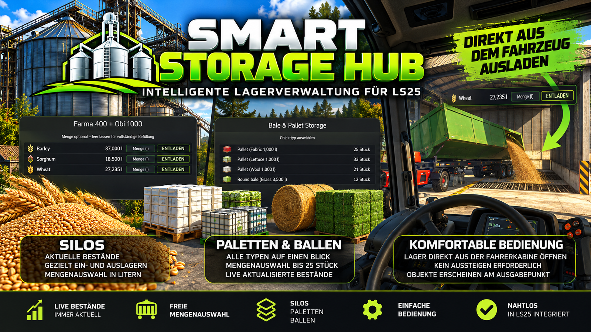
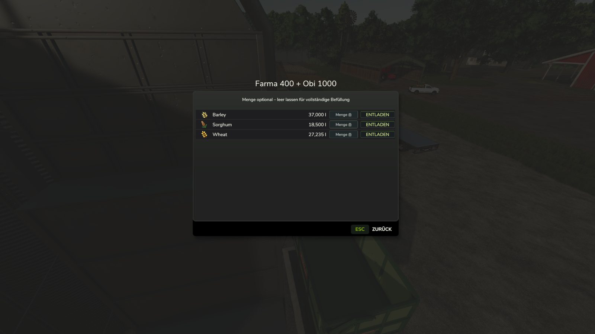
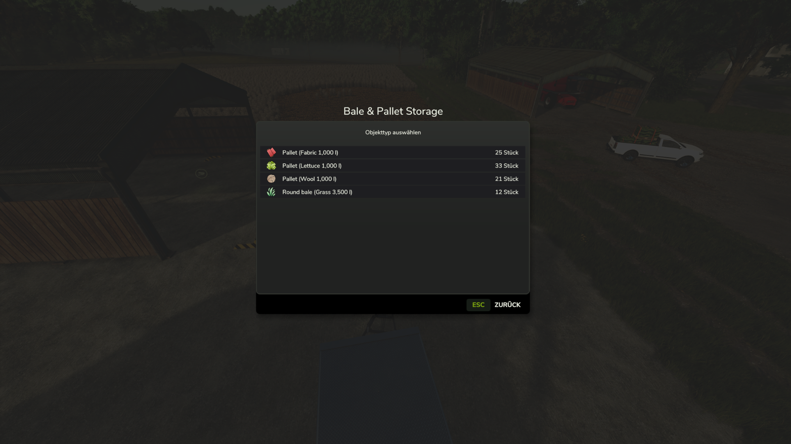
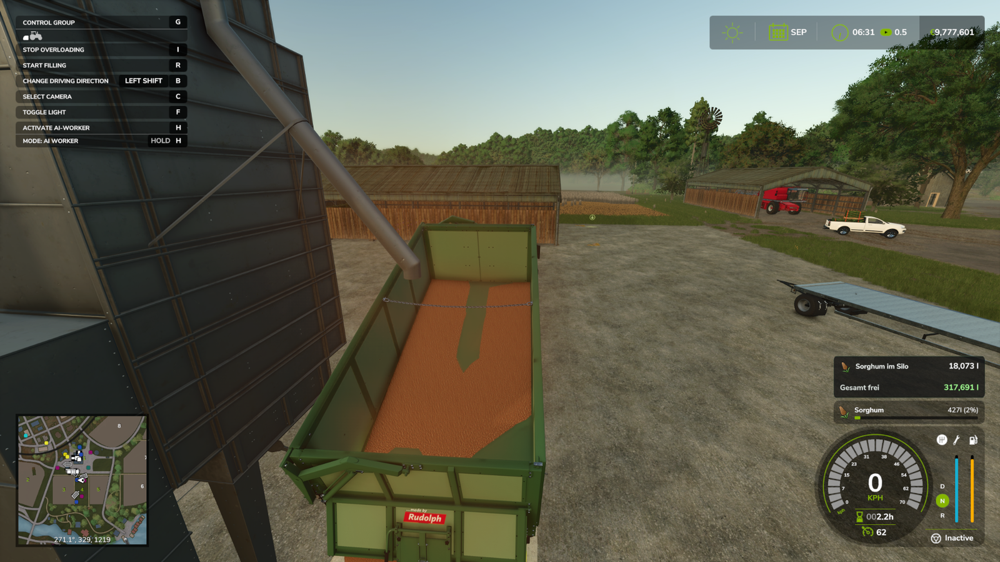
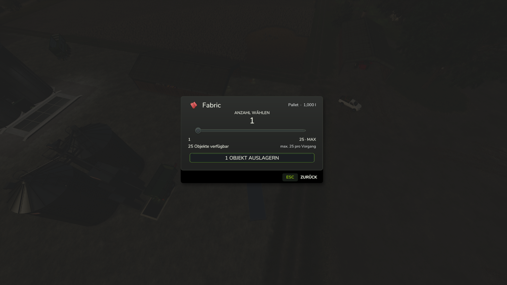

# Smart Storage Hub

# Smart Storage Hub

**Mehr Übersicht. Mehr Kontrolle. Weniger Aufwand.**  
**More overview. More control. Less effort.**

**Farming Simulator 25 · Version 0.9.14.41**

[Deutsch](#deutsch) · [English](#english) · [Download / Releases](https://github.com/Elimods90/FS25_SmartStorageHub/releases)

---

## Deutsch

Smart Storage Hub erweitert die Lagerverwaltung im Landwirtschafts-Simulator 25 um eine moderne, übersichtliche Benutzeroberfläche und praktische Funktionen zur gezielten Ein- und Auslagerung.

Ob Getreidesilo, Palettenlager oder Ballenlager: Mit Smart Storage Hub behältst du deine Bestände im Blick und entscheidest selbst, welche Waren du in welcher Menge entnehmen möchtest.

### Intelligente Siloverwaltung

Alle verfügbaren Fruchtsorten werden mit ihren aktuellen Lagerbeständen und passenden Symbolen übersichtlich dargestellt. Wähle die gewünschte Fruchtsorte aus und starte die Beladung. Optional kannst du eine genaue Literzahl vorgeben. Bleibt das Eingabefeld leer, wird dein Anhänger wie gewohnt befüllt.

Eine zusätzliche Live-Anzeige informiert während des Be- und Entladens über aktuelle Bestände beziehungsweise verbleibende Silokapazität. Farblich gekennzeichnete Werte erleichtern die Orientierung.

### Paletten- und Ballenlager im Überblick

Smart Storage Hub zeigt die eingelagerten Paletten- und Ballenarten mit ihren jeweiligen Stückzahlen. Über die Mengenauswahl bestimmst du, wie viele Objekte ausgelagert werden – **bis zu 25 pro Vorgang**. Die Stückzahlen aktualisieren sich auch bei geöffnetem Auswahlmenü.

### Komfortable Bedienung aus der Fahrerkabine

Mit einem geeigneten, stehenden Transportfahrzeug kannst du in der Nähe eines Paletten- oder Ballenlagers die Lagerauswahl **direkt aus der Fahrerkabine** öffnen. Aussteigen ist nicht erforderlich.

**Wichtig:** Die ausgewählten Objekte erscheinen am regulären Ausgabepunkt des Lagers. Sie werden **nicht automatisch auf dein Fahrzeug geladen**.

### Weitere Funktionen

- Gezielte Liter-Eingabe oder normale vollständige Befüllung am Silo.
- Laufende Bestandsanzeige während der Silo-Bedienung.
- Rechtsbündig ausgerichtete Mengen- und Stückzahlangaben für bessere Lesbarkeit.
- Objektauswahl und Auslagerung in Schritten von bis zu 25 Stück.
- Bedienung nahe geeigneter Lager direkt vom Fahrersitz aus.
- Integration in die vorhandenen LS25-Lagerfunktionen.

### Installation

1. Lade `FS25_SmartStorageHub.zip` aus den [Releases](https://github.com/Elimods90/FS25_SmartStorageHub/releases) herunter, sobald die Version veröffentlicht ist.
2. Kopiere die **ZIP unverändert** in deinen LS25-Ordner `mods`.
3. Aktiviere **Smart Storage Hub** beim Laden deines Spielstands.

Die Mod ist für die PC-Version von Farming Simulator 25 gedacht. Multiplayer-Unterstützung ist im Mod deklariert, wurde für diese Version jedoch noch nicht gesondert praktisch verifiziert.

**Smart Storage Hub – Deine Lager. Deine Bestände. Deine Entscheidung.**

---

## English

Smart Storage Hub enhances storage management in Farming Simulator 25 with a modern, easy-to-read interface and practical tools for managing stored goods.

Whether you are working with grain silos, pallet storage or bale storage, Smart Storage Hub helps you keep track of your inventory and choose what to retrieve and how much.

### Smart silo management

Available fill types are displayed with their current quantities and matching icons. Select the desired crop and begin loading. You can optionally enter an exact amount in litres; leave the field empty to fill your trailer normally.

An additional live display shows the current inventory or remaining silo capacity during loading and unloading, with colour-coded values for quick reference.

### Pallet and bale storage overview

Stored pallet and bale types are displayed together with their current counts. Choose how many objects to retrieve with the quantity selector, **up to 25 per operation**. Counts continue updating while the selection menu is open.

### Access storage from your vehicle

When stationary in a suitable transport vehicle near a pallet or bale storage building, you can open the storage menu **without leaving the driver's seat**.

**Note:** Retrieved items spawn at the storage building's normal output area. They are **not automatically loaded onto your vehicle**.

### Additional features

- Precise litre input or normal full-trailer silo loading.
- Live inventory readout while using silos.
- Right-aligned quantity columns for easier reading.
- Pallet and bale selection, up to 25 objects per operation.
- Convenient storage access from suitable nearby vehicles.
- Integration with existing Farming Simulator 25 storage mechanics.

### Installation

1. Download `FS25_SmartStorageHub.zip` from [Releases](https://github.com/Elimods90/FS25_SmartStorageHub/releases) when available.
2. Copy the ZIP file **without extracting it** into your Farming Simulator 25 `mods` folder.
3. Enable **Smart Storage Hub** for your savegame.

This mod targets the PC version of Farming Simulator 25. Multiplayer support is declared in the mod, but has not yet been separately verified in a practical multiplayer test for this release.

**Smart Storage Hub – Your storage. Your inventory. Your choice.**

---

## Additional screenshots / Weitere Screenshots

**Live silo HUD / Live-Siloanzeige**

**Pallet and bale quantity selection / Mengenauswahl für Paletten und Ballen**

---

Smart Storage Hub · Farming Simulator 25 · v0.9.14.41

